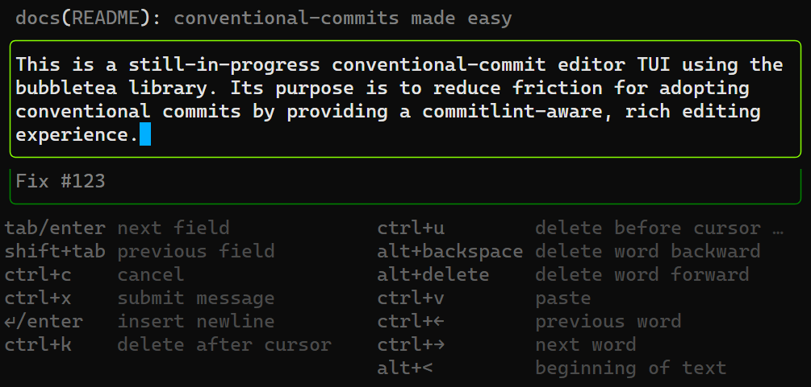

# committed

[](https://pkg.go.dev/github.com/jaredreisinger/committed)

[](https://github.com/JaredReisinger/committed/actions/workflows/ci.yaml)
[](https://app.codacy.com/gh/JaredReisinger/committed)
[](https://app.codecov.io/gh/JaredReisinger/committed)


A bubbletea-powered text UI that functions as a smart, conventional-commit-aware editor for Git



## Features

- Interactive TUI for composing conventional commits
- Automatic detection and enforcement of project conventions
- Proper handling when re-using an existing commit message
- Real-time validation with helpful error messages


## Getting started

How you install `committed` depends on how you intend to use it.

- _Are you someone who commits across several repos, of any programming language, and you want something to make it easier to edit conventional commit messages?_ See the [**Global installation**](#global-installation) instructions.

- _Are you a Go developer, and you want easy access to `committed` in your projects for you and for any contributors?_ See the [**Project installation**](#project-installation) instructions.

### Global installation

1. Find the binary appropriate to your platform [Releases](https://github.com/JaredReisinger/committed/releases) page, or install using Go:

   ```bash
   go install github.com/jaredreisinger/committed@latest
   ```

   > [!NOTE]
   >
   > No self-installing bash/powershell script yet, but I’m looking at what tools like Homebrew do, and might put something together to make the non-`go install` case a one-liner.

2. Configure Git to use `committed` as your `core.editor` either globally or on a repo-by-repo basis:

   ```bash
   # use committed in all repos by default
   git config set --global core.editor committed

   # use committed in only the current repo
   git config set --local core.editor committed
   ```

When you `git commit`, Git will now invoke `committed` to edit your commit messages.

### Project installation

If you want to ensure `committed` is available to all contributors to your Go project, and you’re on Go 1.24 or newer, you can add `committed` as a tool:

```bash
go get -tool github.com/jaredreisinger/committed@latest
```

This adds `committed` as a tool to your project’s `go.mod`, and any `go mod download` or `go mod tidy` command will ensure that it is downloaded and available.

To use it, invoke `go tool committed`. You can configure your repo to _always_ use `committed` for editing commit messages by setting `core.editor`:

```bash
git config set --local core.editor "go tool committed"
```

Let your contributors know that they can also set `core.editor` the same way.

## Configuration

`committed` automatically detects conventional commit configuration from:

1. `.commitlintrc.json`
2. `.commitlintrc.{yaml,yml}`
3. `package.json` (commitizen field)

### Example `.commitlintrc.json`

```json
{
  "rules": {
    "type-enum": [
      2,
      "always",
      [
        "feat",
        "fix",
        "docs",
        "style",
        "refactor",
        "perf",
        "test",
        "chore",
        "revert"
      ]
    ],
    "subject-max-length": [2, "always", 72]
  }
}
```

## Additional options

> [!WARNING]
>
> TBD / NYI — I’m planning to add CLI flags to allow for additional customization, like choosing to directly edit the “type” field vs. using the type picker.  Those will get documented here once they’re implemented.

## Want to help? Have feedback?

Read the [contribution guidelines](docs/CONTRIBUTING.md).
